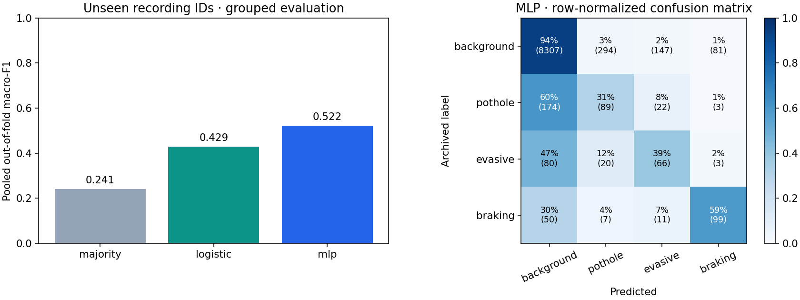

# Cycling Safety ML

**Reproducible classification of cycling IMU windows, evaluated on held-out recordings.**

An independent continuation by **Juan Andrés Vallejo Rozo** of the collaborative [CyclingSafety academic project](https://github.com/Andres-Vallejo/CyclingSafety). The original project remains intact. The [original team, source snapshot and license](AUTHORS.md) are explicitly preserved.

[Español](README_ES.md) · [Methodology](docs/METHODOLOGY.md) · [Data card](docs/DATA_CARD.md) · [Model card](docs/MODEL_CARD.md) · [What changed](docs/CHANGES.md)

## What this version does

- Reads the team's original accelerometer, gyroscope and annotation CSVs directly from the downloaded ZIP export.
- Rebuilds 50 Hz, 128-sample windows with explicit missing-data and label rules.
- Keeps whole recording IDs together in every train/validation/test partition.
- Compares a majority baseline, logistic regression, a newly trained MLP and a small newly trained 1D CNN.
- Saves out-of-fold predictions, recording assignments, hyperparameter decisions, class metrics and data hashes.
- Provides a portable MLP JSON model, CSV inference and a local FastAPI service.

**Scope:** a research prototype using annotation-button times as proxy labels. Predictions are not verified road incidents or safety warnings. Recording separation does not prove performance on unseen riders or devices.

## Evaluation

The rebuilt dataset contains **9,453 windows from 11 recordings**. The preprocessing audit excludes 750 candidate windows with sensor gaps, 20 with conflicting event types and 617 background candidates too close to annotations. No historical augmented copies are used.

| Experiment | Procedure | Evidence |
|---|---|---|
| Majority, logistic regression and MLP | 5 outer recording folds; 3 inner recording folds for hyperparameters | [Report](reports/grouped-mlp/REPORT.md) · [Metrics](reports/grouped-mlp/metrics.json) |
| Small 1D CNN | Same outer folds; architecture and 15-epoch budget fixed before evaluation | [Report](reports/grouped-cnn/REPORT.md) · [Metrics](reports/grouped-cnn/metrics.json) |



The primary metric is **pooled out-of-fold macro-F1 over four classes**. Accuracy and per-class precision/recall are also reported. Historical notebook scores use a different evaluation protocol and are not presented as directly comparable improvements.

| Model | OOF accuracy | OOF macro-F1 |
|---|---:|---:|
| Majority baseline | 93.40% | 0.2415 |
| Logistic regression | 77.68% | 0.4288 |
| MLP | 90.56% | 0.5217 |
| Fixed 1D CNN | 86.95% | 0.5221 |

The similar MLP/CNN F1 scores do not establish a winner. The data is highly imbalanced, and the MLP reached its 200-iteration budget in 41 fits across tuning and refitting. This initial fixed-budget benchmark and its limitations are retained for future comparisons. All recordings share one logged phone and two collection days.

## Run the included model

Use **Python 3.12** from the repository root:

```bash
python -m venv .venv
# Windows PowerShell: .venv\Scripts\Activate.ps1
# Linux/macOS: source .venv/bin/activate
python -m pip install -r requirements-core.lock.txt
python -m pip install --no-deps -e .
cycling-ml predict --csv examples/example_features.csv --output predictions.json
```

The example contains four feature vectors from the rebuilt recordings with no GPS or recording names. It demonstrates the interface; the all-data model has already seen these inputs, so the example is not a test set.

## Use the local API

```bash
uvicorn cycling_safety.api:create_app --factory --host 127.0.0.1 --port 8000
```

Open <http://127.0.0.1:8000/docs>. `GET /schema` lists the exact 72 feature names. Send `examples/example_request.json` to `POST /predict`; unexpected columns, nonfinite values and malformed requests are rejected. Scores are uncalibrated model probabilities.

The API consumes **window features**, not arbitrary raw CSV uploads. `features_from_window` supports one already synchronized 128 × 6 IMU window. Raw resampling and annotation handling are separate, documented steps.

```bash
docker build -t cycling-safety-ml .
docker run --rm -p 127.0.0.1:8000:8000 cycling-safety-ml
```

Docker packaging is supplied; consult [validation status](docs/CHANGES.md) for what was actually executed.

## Reproduce training

Raw recordings remain local inputs. Supply both ZIP parts from **one complete export**, rather than mixing exports. The importer does not extract files, execute archive contents or load GPS.

```bash
cycling-ml prepare-raw --archives /path/to/part-001.zip /path/to/part-002.zip --output data/rebuilt
cycling-ml evaluate --data data/rebuilt --output runs/feature-evaluation --seed 42 --outer-folds 5 --inner-folds 3 --max-iter 200

# Optional CPU CNN dependency, installed from the official PyTorch index:
python -m pip install torch==2.8.0 --index-url https://download.pytorch.org/whl/cpu
cycling-ml evaluate-cnn --data data/rebuilt --output runs/cnn-evaluation --seed 42 --folds 5 --epochs 15
```

Output directories must be empty, preventing accidental replacement of prior experiments. Reports include the data checksum, configuration, fold assignments and environment. Reproducing results requires the same input hashes and software environment.

## Development

```bash
python -m pip install -r requirements-dev.lock.txt
python -m pytest -q
```

Tests cover recording leakage, nested selection boundaries, training-only scaling, sensor gaps, ambiguous labels, named sensor axes, portable model parity, API validation and command-line inference. CNN-specific tests run when PyTorch is installed.

```text
src/cycling_safety/   Import, preprocessing, evaluation, models, inference and API
tests/               Regression tests and synthetic reference fixtures
reports/             Executed experiments and out-of-fold predictions
artifacts/           New all-data MLP and CNN refits
examples/            Small inference examples
provenance/          Academic snapshot, source hashes and preserved credits
docs/                Methodology, data/model cards and change record
```

Data folders and training runs are ignored by Git. Publication of raw recordings requires a separate data-rights decision; software attribution and the MIT license are retained.
