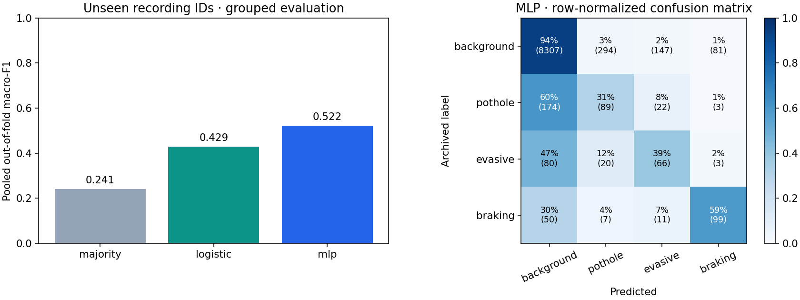

# Cycling Safety ML

**Clasificación reproducible de ventanas IMU de ciclismo, evaluada con grabaciones completas fuera del entrenamiento.**

Esta es una evolución independiente mantenida por **Juan Andrés Vallejo Rozo**, construida sobre el [proyecto académico CyclingSafety](https://github.com/Andres-Vallejo/CyclingSafety). El original se conserva intacto y los [créditos del equipo y la licencia](AUTHORS.md) siguen explícitos.

[English and commands](README.md) · [Metodología](docs/METHODOLOGY.md) · [Datos](docs/DATA_CARD.md) · [Modelos](docs/MODEL_CARD.md)

## Qué se reconstruyó

Se leen directamente los CSV originales de aceleración, giroscopio y anotaciones. El nuevo procesamiento sincroniza los sensores a 50 Hz y construye ventanas de 128 muestras con desplazamiento de 64.

De 10.840 ventanas candidatas, se conservan **9.453 de 11 grabaciones**. Se excluyen 750 por huecos en las señales, 20 por contener anotaciones de clases diferentes y 617 posibles ventanas de fondo por su cercanía a una anotación.

La evaluación compara un predictor de clase mayoritaria, regresión logística, un MLP nuevo y una CNN 1D pequeña entrenada desde cero. Las copias aumentadas, las máscaras de partición, los modelos y las predicciones del experimento histórico no se utilizan.

## Cómo se corrigió la evaluación

- Todas las ventanas de una grabación permanecen juntas.
- Se usan cinco particiones externas para predecir sobre grabaciones no vistas.
- Para regresión logística y MLP, tres particiones internas seleccionan los hiperparámetros usando únicamente las grabaciones de entrenamiento externas.
- La normalización y los pesos de clase se calculan en cada conjunto de entrenamiento.
- La CNN utiliza una arquitectura y un presupuesto de 15 épocas fijados antes de mirar sus predicciones de prueba.
- Cada ventana recibe exactamente una predicción fuera de muestra por familia de modelo.

Los resultados incluyen F1 macro, precisión y sensibilidad por clase, matriz de confusión, variación entre particiones y predicciones auditables. [Resultados MLP y modelos de referencia](reports/grouped-mlp/REPORT.md) · [Resultados CNN](reports/grouped-cnn/REPORT.md).

| Modelo | Exactitud fuera de muestra | F1 macro |
|---|---:|---:|
| Clase mayoritaria | 93,40 % | 0,2415 |
| Regresión logística | 77,68 % | 0,4288 |
| MLP | 90,56 % | 0,5217 |
| CNN 1D fija | 86,95 % | 0,5221 |

La similitud del F1 de MLP y CNN no permite declarar un ganador. El MLP alcanzó el límite de 200 iteraciones en 41 ajustes, que se registran como parte de las limitaciones de este primer experimento. La colección corresponde a un teléfono registrado y dos días.

## Qué demuestra y qué falta

Esta evaluación mide generalización entre los identificadores de grabación disponibles. Las anotaciones son marcas de botón, no intervalos verificados del evento físico. La clase `background` significa fondo sin anotación cercana; no equivale a conducción normal confirmada. Las ventanas solapadas no son incidentes independientes.

El proyecto tampoco demuestra generalización a otros ciclistas, teléfonos o ciudades. Los modelos finales se vuelven a entrenar con las once grabaciones para una demo; sus resultados se describen mediante la evaluación del procedimiento, no mediante una prueba independiente de ese ajuste final.

## Qué puedes ejecutar

La versión incluye inferencia desde un CSV de 72 características, un modelo MLP en JSON, una API local con validación, pruebas automatizadas y preparación para Docker. Los comandos completos están en el [README principal](README.md).

Los datos originales quedan como entradas locales. La carpeta `provenance/` conserva la identidad del proyecto del equipo; el código de esta continuación y sus nuevos resultados están organizados por separado. El estado de validación y las tareas pendientes se documentan en [CHANGES](docs/CHANGES.md).
