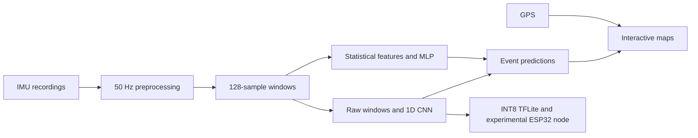

# CyclingSafety

**Recognizing urban cycling safety events from motion sensors and visualizing their locations.**

A collaborative academic project combining smartphone IMU signals, **MLP and 1D CNN models**, GPS-based maps, and an experimental **ESP32/TinyML** node.

**Juan Andrés Vallejo Rozo's contribution:** model construction and preliminary training, later used by a teammate to generate the maps. This independent portfolio copy preserves the [original project](https://github.com/w1sec0d/CyclingSafety), its team credits and [MIT license](LICENSE).

[Español](README_ES.md) · [Team](AUTHORS.md) · [Visual gallery](docs/GALLERY.md) · [Technical review](docs/REVIEW.md) · [Setup](docs/SETUP.md)

## From predictions to locations

[](outputs/map_combined.html)

*Local coordinate preview of the existing prediction CSV. These are model predictions, not verified crashes or a validated road-risk ranking.*

| Interactive map | Contents |
|---|---|
| [Combined map](outputs/map_combined.html) | Route traces, event predictions and severity layers |
| [Classified events](outputs/map_mlp_events.html) | Georeferenced event predictions |
| [Severity heatmap](outputs/map_severity_heatmap.html) | Spatial concentration of a model-derived score |

Download the repository and open the map HTML files in a browser to interact with them. GitHub displays their source. The Folium files use external scripts and map tiles; the static preview above does not consult those services.

[](outputs/map_severity_heatmap.html)

*Mean saved severity score per spatial bin, generated locally. This preview is an aggregation of the existing scores, not a new validated risk model.*

## What we built

The team explored the recognition of **pothole impacts, evasive maneuvers and emergency braking** from accelerometer and gyroscope signals. The pipeline resamples recordings to 50 Hz, builds overlapping 128-sample windows and compares:

- **MLP:** classification from statistical features extracted from each window.
- **1D CNN:** temporal feature learning from the six raw IMU channels.

Predictions are associated with GPS for visualization. The repository includes trained models, hyperparameter-search artifacts, an INT8 TFLite export and firmware for an ESP32, MPU-6050, GPS and microSD prototype.



## Preliminary model comparison


These are **saved notebook results**, not new training runs:

| Supervised four-class model | Recorded accuracy | Recorded macro-F1 |
|---|---:|---:|
| MLP with statistical features | 97.91% | 0.8942 |
| Manual 1D CNN | 96.13% | 0.6936 |
| 1D CNN with KerasTuner search | 99.14% | 0.9468 |

**Interpretation:** the existing split shares recordings and overlapping windows between training and test. Training also contains **303 augmented copies derived from test windows and 300 from validation windows**. These scores are exploratory and may be optimistic; they do not establish performance on unseen rides. See the [review](docs/REVIEW.md).

<details>
<summary>View the saved supervised CNN confusion matrices</summary>


The figure retains the notebook's original titles. Its test partition is window-based, despite the original route-level wording in some outputs.

</details>

## Included artifacts

- **45,062** window metadata rows: 32,218 natural, 10,840 controlled and 2,004 augmented.
- **32,218** mapped predictions: 31,084 normal, 812 pothole, 283 braking and 39 evasive-maneuver predictions.
- MLP models with **72 features** and CNN models with **128 × 6** input windows.
- A **232,656-byte INT8 TFLite model** and a C header containing the same model bytes.

The raw recordings are distributed separately through the links in the [original overview](README_UPSTREAM.md). The full raw-window tensor is not included; complete CNN retraining requires rebuilding it from the input data.

## Quick local inspection

```bash
python examples/inspect_artifacts.py
```

This uses only Python's standard library. It inspects saved artifacts without retraining, contacting a broker or loading pickle files. See [setup](docs/SETUP.md) for notebooks, preprocessing and hardware instructions.

## Changes in this copy

The model artifacts, prediction data and historical metrics are retained. Added material includes bilingual portfolio documentation, team attribution, notebook figures, a local spatial preview and an artifact inspector. Missing dependencies and MQTT configuration examples were added.

The ESP32 sketch is now in an Arduino-compatible folder. Its window was corrected from **120 to 128 samples** to match the included TFLite model; runtime tensor checks and output dequantization were added. These adjustments were inspected against the artifacts but **not validated on a physical board**. Smartphone-to-device calibration and field evaluation remain important limitations.

## Team and license

**Juan Andrés Vallejo Rozo · Andrés Felipe Rojas Aguilar · Brayan Camilo Rodríguez Diaz · Carlos David Ramírez Muñoz**

See [AUTHORS.md](AUTHORS.md) for contributions. Distributed under the original [MIT license](LICENSE).
