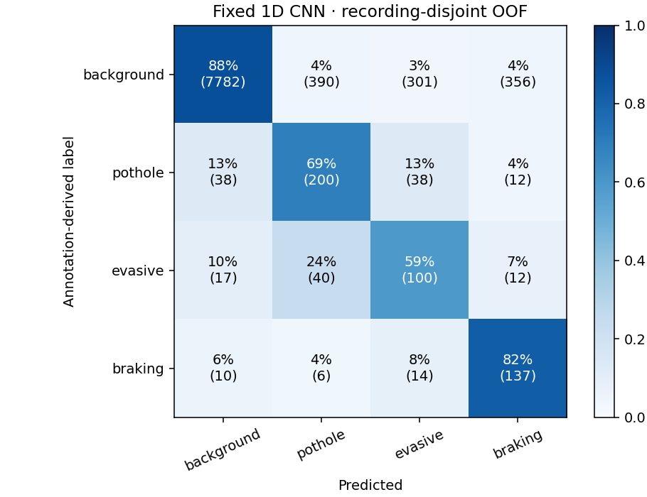

# Fixed 1D CNN recording-disjoint evaluation

9,453 windows from 11 recordings. 5 held-out group folds, 15 fixed training epochs per fold. No architecture or epoch selection uses held-out labels.

Pooled OOF macro-F1: **0.5221**. Accuracy: **86.95%**.

| Label | Precision | Recall | F1 | Windows |
|---|---:|---:|---:|---:|
| background | 0.9917 | 0.8814 | 0.9333 | 8829 |
| pothole | 0.3145 | 0.6944 | 0.4329 | 288 |
| evasive_maneuver | 0.2208 | 0.5917 | 0.3215 | 169 |
| emergency_braking | 0.2650 | 0.8204 | 0.4006 | 167 |

These labels use recorded button-press times, not verified physical event intervals. Background is unannotated background after a guard period, not verified safe riding. Overlapping windows do not count independent incidents. Recording separation does not prove unseen-rider, session or device performance.

cnn_weights.pt is an all-data refit. OOF metrics characterize the fixed training procedure, not an independently tested final artifact. No ESP32, TFLite quantization, production latency or field safety validation was performed.
