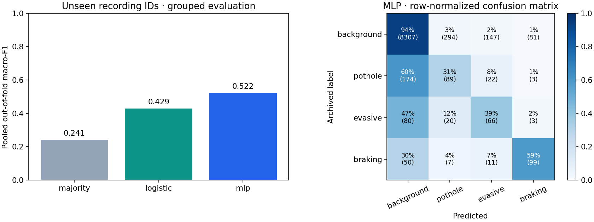

# Recording-disjoint evaluation

9,453 nonaugmented windows from 11 annotated recordings. 5 outer recording-group folds; 3 inner group folds select hyperparameters. All 72 input features are per-window statistics. Every window is tested once per model family.

| Model family | OOF accuracy | OOF macro-F1 | Recording-bootstrap 95% interval |
|---|---:|---:|---:|
| majority | 93.40% | 0.2415 | [0.2388, 0.2439] |
| logistic | 77.68% | 0.4288 | [0.3776, 0.4756] |
| mlp | 90.56% | 0.5217 | [0.4738, 0.5627] |

## MLP per-class results

| Archived label | Precision | Recall | F1 | Support (windows) |
|---|---:|---:|---:|---:|
| background | 0.9647 | 0.9409 | 0.9526 | 8829 |
| pothole | 0.2171 | 0.3090 | 0.2550 | 288 |
| evasive_maneuver | 0.2683 | 0.3905 | 0.3181 | 169 |
| emergency_braking | 0.5323 | 0.5928 | 0.5609 | 167 |

## Interpretation

The bootstrap resamples complete recordings, conditional on the saved OOF predictions. It is not a model-refit confidence interval. Only 11 recordings are available; fold variability is saved in metrics.json.

Background means no recognized archived annotation, not independently verified normal riding. Rider identity and verified event-instance boundaries are unavailable. Recording-disjoint results do not establish generalization to unseen riders, unseen cities, or independent incidents. Overlapping windows are not independent events.

The original scores used a different split and augmentation procedure. A before/after performance ranking would be misleading. The data manifest documents whether inputs were rebuilt from raw sensors or imported as archived features. Annotation press times are not verified physical event boundaries. ESP32 inference has not been tested here. A separately executed CNN experiment, when present, has its own report.

The deployment JSON is an MLP refitted on all 11 recordings after grouped hyperparameter selection. The table evaluates the training procedure using OOF models, not this final refit on an independent test set.

Training reached its iteration budget in 41 fits (see saved search records). Convergence warnings are disclosed rather than hidden.

This is a research prototype, not a safety alert or validated road-risk assessment system.
